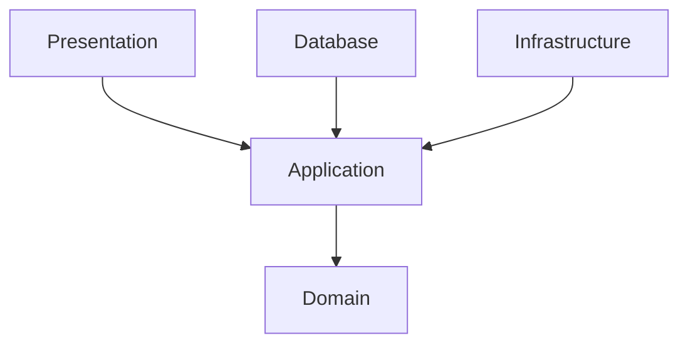

# Архитектура решења

Систем: „План самосталног учења“ (практични задатак 008). За сваки принцип навођене су конкретне класе или
интерфејси и начин провере (тест или могућност замене имплементације).

## SRP — једна одговорност

- **Правило П3 и обавезна поља:** `ZapisPravila` (пројекат `Domain`) садржи само проверу назива, описа, области и трајања 5–300 минута.
- **Извршавање операција F1–F6:** три одвојена сервиса у `Application`: `ZapisServis` (F1, F2), `ZapisPregledServis` (F3, F4), `ZapisStatusServis` (F5, F6).
- **Складиштење:** `InMemoryZapisiRepozitorijum` и `JsonZapisiRepozitorijum` (пројекат `Database`).
- **Форматирање приказа:** `SazetiFormater` и `DetaljniFormater` (пројекат `Presentation`). Сервиси не граде текст за приказ и не читају са конзоле.
- **Провера:** `DomenTests` проверава правило П3 и прелазе стања без иједне зависности. `ZapisServisTests` покреће сервис са лажним репозиторијумом и логером, без конзоле и датотека. `LayeringTests.Domain_NemaZavisnostiOdSpoljasnjihProjekata` потврђује да `Domain` не зависи од осталих пројеката.

## OCP — отвореност за проширење

- **Уговор:** `IZapisFormater` (`Naziv`, `Formatiraj(Zapis)`) у `Application`.
- **Две имплементације за F3:** `SazetiFormater` (тип, ID, назив, статус) и `DetaljniFormater` (додатно област, трајање, опис, поглавље односно датум претходног учења).
- **Нови формат** се додаје новом класом која имплементира `IZapisFormater` и једном линијом у листи `AppContainer.Formateri`; пословни сервиси се не мењају. Мени тренутно нуди прва два формата (сажети и детаљни).
- **Провера:** `FormaterTests.Formatiraj_TrecaImplementacija_RadiBezIzmeneServisa` користи трећи форматер дефинисан у самом тесту, уз непромењен `ZapisPregledServis`.

## LSP — заменљивост имплементација

- **Уговор:** `IZapisiRepozitorijum` (`Sacuvaj`, `Azuriraj`, `Pronadji`, `Svi`).
- **Имплементације:** `InMemoryZapisiRepozitorijum` и `JsonZapisiRepozitorijum`. Обе чувају обе врсте записа (`NovaTema`, `Ponavljanje`), враћају исте кодове грешака (`repo.vec_postoji`, `repo.nije_pronadjen`) и поступају исто са непостојећим идентификатором.
- **Провера:** апстрактна класа `ZapisiRepozitorijumUgovorTests` садржи све тестове уговора (упис, читање обе врсте записа, непостојећи идентификатор). Наслеђују је `InMemoryZapisiRepozitorijumTests` и `JsonZapisiRepozitorijumTests`, па обе имплементације пролазе потпуно исте тестове. `JsonZapisiRepozitorijumTests` додатно проверава да су подаци доступни након поновног отварања и да неисправан JSON не уништава датотеку.

## ISP — раздвајање интерфејса

- **Подела:** `IZapisiRepozitorijum` је раздвојен на `IZapisiCitanje` (`Pronadji`, `Svi`) и `IZapisiUpis` (`Sacuvaj`, `Azuriraj`). `IZapisiRepozitorijum` их само обједињује, а репозиторијуми имплементирају оба.
- **Употреба:** `ZapisPregledServis` (F3, F4) зависи само од `IZapisiCitanje`. `ZapisServis` зависи само од `IZapisiUpis`. `ZapisStatusServis` користи оба, јер прво чита, а затим ажурира.
- **Провера:** `DizajnTests.ZapisPregledServis_Konstruktor_ZavisiSamoOdInterfejsaZaCitanje` проверава рефлексијом да је једини параметар конструктора `IZapisiCitanje`.

## DIP — инверзија зависности

- **Конструкторско прослеђивање:** `ZapisServis(IZapisiUpis, ILoggerServis, IClock)`, `ZapisPregledServis(IZapisiCitanje)`, `ZapisStatusServis(IZapisiCitanje, IZapisiUpis, ILoggerServis)`. Сервиси не стварају инфраструктурне објекте.
- **Избор имплементација:** `AppContainer.Create(rezim, logerRezim)` бира репозиторијум (`in-memory` или `json`) и логер (`file` — `FileLoggerServis`, `console` — `ConsoleLoggerServis`). Врста чувања се мења аргументом при покретању, без измене у `Domain` и `Application`.
- **Провера:** `DizajnTests.PoslovniServisi_Konstruktor_PrimaSamoInterfejse` и `DizajnTests.AppContainer_Create_BiraRepozitorijumPremaRezimu` / `AppContainer_Create_BiraLoggerPremaRezimu`. Сервиси се тестирају уз `Moq` репозиторијум и логер (`ZapisServisTests`).

## Clean Architecture — смер зависности

| Пројекат | Референцира | Улога |
|---|---|---|
| `Domain` | — | Модели, правила, прелази стања |
| `Application` | `Domain` | Случајеви употребе, уговори (интерфејси), `Result` |
| `Database` | `Application`, `Domain` | Меморијски и JSON репозиторијум |
| `Infrastructure` | `Application` | Логери (`FileLoggerServis`, `ConsoleLoggerServis`), `SystemClock` |
| `Presentation` | сви пројекти | Мени и `AppContainer` (корен композиције) |

`Presentation` је једини пројекат који зна за конкретне имплементације: он их само повезује у `AppContainer`. `Domain` и `Application`
не референцирају `Database`, `Infrastructure` ни `Presentation`; то проверавају `LayeringTests`.
`Domain` има сопствени `DomenskiRezultat`, јер не сме да референцира `Application` (где је `Result`).
